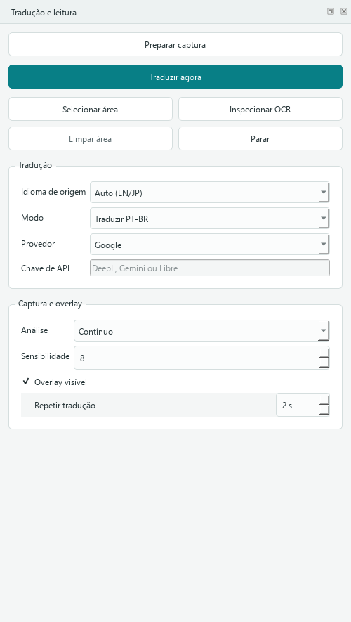
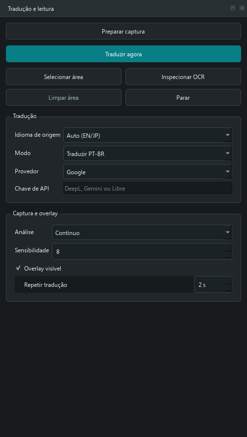
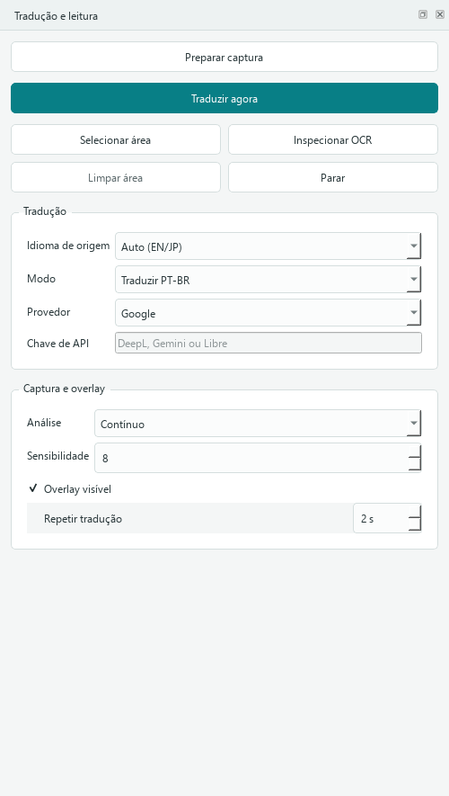

# UltraOCR — Manga Real-Time Translator

Tradutor e leitor em tempo real para mangás, manhwas, manhuas e HQs no Windows. Captura a janela/página, faz OCR local, traduz para português brasileiro (pt-BR) e mostra a tradução em um overlay sem modificar o site.

---

## Sumário

- [Visão Geral](#visão-geral)
- [Funcionalidades](#funcionalidades)
- [Capturas Reais](#capturas-reais)
- [Requisitos](#requisitos)
- [Instalação](#instalação)
- [Configuração](#configuração)
- [Uso](#uso)
- [Provedores de Tradução](#provedores-de-tradução)
- [Rate Limiter Adaptativo](#rate-limiter-adaptativo)
- [OCR](#ocr)
- [Detector de Texto (Comic)](#detector-de-texto-comic)
- [Overlay](#overlay)
- [Arquitetura](#arquitetura)
- [Comandos CLI](#comandos-cli)
- [Scripts de Validação](#scripts-de-validação)
- [Testes](#testes)
- [Problemas Conhecidos](#problemas-conhecidos)
- [Roadmap](#roadmap)
- [Licença](#licença)

---

## Visão Geral

O UltraOCR é um leitor de mangá/desktop que:

1. **Captura** a janela do leitor por Windows Graphics Capture (WGC), com DXGI/dxcam e viewport Qt como fallback
2. **Detecta** balões de texto com detecção ONNX (GPU) ou PaddleOCR
3. **Reconhece** o texto via PaddleOCR (local, sem internet)
4. **Traduz** o texto via Argos local ou Google Translate, Gemini, DeepL ou LibreTranslate
5. **Renderiza** a tradução em português sobre o texto original em um overlay transparente

O leitor gráfico e a captura de janela estão implementados para Windows. OCR roda
localmente; provedores de tradução online precisam de internet. DirectML/GPU é
opcional e usado apenas pelo detector ONNX experimental.

Durante a rolagem, o overlay anterior é ocultado sem descartar seus dados. A
nova geração substitui todos os balões de uma vez somente depois que OCR,
cache e tradução terminam. Cada balão carrega um hash visual persistente para
evitar duplicação, oscilação de posição e retradução desnecessária.

Se a rolagem interromper OCR ou tradução, o leitor agenda uma releitura completa
da viewport após estabilizar; quando nenhum trabalho foi interrompido, mantém a
otimização incremental da faixa recém-exposta. Google, Gemini, DeepL e Libre
podem ser trocados durante a sessão sem reiniciar a captura.

O app não modifica o site original — tudo acontece em uma janela overlay por cima do navegador.

---

## Funcionalidades

| Recurso | Status |
|---------|--------|
| Captura de tela via DXGI (GPU) | ✅ |
| Captura WGC por janela com atualização por evento (sem exigir foco) | ✅ |
| Captura externa recalcula a região ao mover/restaurar a janela | ✅ |
| Overlay externo acompanha monitor, origem e escala do recorte | ✅ |
| Captura viewport via Qt | ✅ |
| OCR local (PaddleOCR) | ✅ |
| Detecção de texto ONNX (GPU, DirectML) | ✅ |
| Google Translate (sem chave; precisa de internet) | ✅ |
| Argos Translate (offline, modelos locais) | ⚠️ Opcional; requer runtime e modelos instalados |
| Gemini LLM (com chave; limites dependem da conta) | ✅ |
| DeepL (API oficial, com chave) | ✅ |
| LibreTranslate (Docker local ilimitado) | ✅ |
| Cache de traduções (SQLite) | ✅ |
| Histórico pesquisável de traduções (SQLite) | ✅ |
| Correção manual no histórico aplicada ao cache reutilizável | ✅ |
| Cache de OCR (por hash de pixels) | ✅ |
| Tradução em lote (1 request por frame) | ✅ |
| Tradução assíncrona (não bloqueia UI) | ✅ |
| Troca de provedor durante a sessão sem reiniciar a captura | ✅ |
| Troca atômica de overlays após rolagem | ✅ |
| Identidade visual persistente dos balões | ✅ |
| Ajuste automático de fonte, prioridade ao balão detectado e prevenção de colisões | ✅ |
| Detecção conservadora dos limites de balões para posicionar o texto | ✅ |
| Fundo adaptativo do balão e contraste automático do texto | ✅ |
| Remoção local dos glifos por inpainting antes do overlay | ✅ |
| Rate limiter adaptativo (backoff + jitter) | ✅ |
| Fallback automático entre provedores | ✅ |
| Glossário de nomes/termos com editor na interface | ✅ |
| Glossário contextual por obra, herdado do global | ✅ |
| Importação e exportação de glossário TOML | ✅ |
| Overlay transparente (janela top-level) | ✅ |
| Modo contínuo (auto-traduz ao rolar vertical ou horizontalmente) | ✅ |
| Modo manual (Ctrl+Shift+T) | ✅ |
| Abrir imagem(ns) local(is) em galeria vertical e traduzir durante a rolagem | ✅ |
| Exportar captura visível com traduções sobrepostas em PNG | ✅ |
| Atalhos globais Windows para traduzir/limpar região | ✅ |
| Perfis locais por site (região e preferências, sem chaves) | ✅ |
| Aparência do overlay por site (fonte, tamanho e opacidade) | ✅ |
| Tema claro/escuro persistente para a interface do leitor | ✅ |
| Interface 100% em português | ✅ |
| Testes automatizados | ✅ |

---

## Capturas Reais

Capturas feitas a partir da interface executável do leitor. O GIF alterna entre
capturas reais do painel nos dois temas; não há telas ou diálogos desenhados,
páginas de terceiros ou chaves de API nas imagens.

| Painel claro | Painel escuro |
|---|---|
|  |  |

O GIF mostra o mesmo painel alternando entre os dois temas:



Para refazer as capturas da interface no Windows, com OCR e rede desativados:

```powershell
.\.venv311\Scripts\python.exe -m pip install -e ".[readme-media]"
.\.venv311\Scripts\python.exe scripts\capture_readme_media.py
```

---

## Requisitos

### Software

- **Windows 10/11** (64-bit)
- **Python 3.11** (versão usada nos testes e recomendada para este ambiente)
- **GPU NVIDIA/AMD/Intel** (opcional; acelera apenas o detector ONNX via DirectML)
- **Git** (para clonar)

### Hardware Recomendado

- 8GB+ de RAM
- GPU dedicada não é obrigatória; o PaddleOCR pode rodar em CPU
- SSD recomendado para carregar os modelos locais mais rápido

### Python Packages

Dependências principais (restrições e versões são mantidas em `requirements.txt`):

- `paddleocr` e `paddlepaddle` (reconhecimento de texto local)
- `paddlex` (pipeline e modelos OCR)
- `onnxruntime-directml` (inferência GPU opcional no Windows)
- `pyside6` (UI + navegador embutido)
- `opencv-python` (processamento de imagem)
- `windows-capture` 2.0.1 (captura de janela WGC no Windows; fallback DXGI se indisponível)

---

## Instalação

### 1. Clonar o repositório

```powershell
git clone https://github.com/shimaski/ultraocr.git
cd ultraocr
```

### 2. Criar ambiente virtual (Python 3.11)

```powershell
py -3.11 -m venv .venv311
.\.venv311\Scripts\Activate.ps1
```

### 3. Instalar dependências

```powershell
pip install -r requirements.txt
```

### 4. Copiar configurações de exemplo

```powershell
Copy-Item config.example.toml config.toml
Copy-Item glossary.example.toml glossary.toml
```

### 5. Configurar chaves de API (opcional)

```powershell
# Gemini (crie uma chave em aistudio.google.com/apikey; limites/preço podem variar)
$env:MANGA_RT_GEMINI_API_KEY = "sua-chave"

# DeepL (consulte os planos atuais em deepl.com/pro-api)
$env:MANGA_RT_DEEPL_API_KEY = "sua-chave"

# LibreTranslate (opcional, para instância pública)
$env:MANGA_RT_LIBRE_API_KEY = "sua-chave"
```

### 6. Iniciar

```powershell
START_READER.bat
```

### Executável de inicialização (Windows)

O repositório inclui os scripts para gerar `UltraOCR.exe`, um launcher que abre
o leitor sem deixar um terminal visível. Para gerá-lo neste computador:

```powershell
.\.venv311\Scripts\python.exe -m pip install -e ".[packaging]"
.\packaging\build_windows.ps1
.\dist\UltraOCR-local\UltraOCR.exe
```

Esse EXE é um iniciador local de desenvolvimento, não um instalador para outras
pessoas: requer a pasta do projeto, o ambiente `.venv311` e as dependências.
Os modelos OCR podem ser baixados na primeira execução. As configurações e o
banco de traduções ficam em `%LOCALAPPDATA%\UltraOCR`.

---

## Configuração

### config.toml

```toml
[ocr]
# Detector de texto: "paddle" (recomendado) ou "comic" (experimental)
detector = "paddle"

# Modelo de reconhecimento: "mobile" (rápido) ou "server" (mais preciso)
rec_model = "mobile"

# Modelo de detecção: "mobile" (rápido) ou "server" (mais preciso)
det_model = "mobile"

# Idiomas extras aumentam o tempo de leitura; deixe vazio salvo se necessário.
# No leitor, o modo Auto tenta japonês como fallback quando apropriado.
extra_langs = []

[translation]
# Provedor padrão: "google", "gemini", "deepl", "libre", "echo"
provider = "gemini"

# Idioma de destino
target_lang = "pt-BR"

# Timeout para requests de tradução (segundos)
timeout_seconds = 6

# Intervalo mínimo entre requests do Gemini (segundos)
gemini_min_interval = 1.0

# Chaves de API (configure via variáveis de ambiente, NÃO no TOML)
# gemini_api_key = ""
# deepl_api_key = ""
# libre_api_key = ""

# URL do LibreTranslate (para Docker local)
# libre_url = "http://localhost:5000"

[overlay]
# Opacidade do overlay (0.0 a 1.0)
opacity = 0.94

# Fonte do overlay
font_family = "Segoe UI"
font_size = 14
```

### glossary.toml

```toml
# Nomes próprios que devem ser preservados na tradução
[names]
"Son Goku" = "Son Goku"
"Naruto" = "Naruto"

# Termos técnicos que devem ser traduzidos de forma específica
[terms]
"Saiyajin" = "Saiyajin"
"Quincy" = "Quincy"
```

---

## Uso

### Modo Principal (Recomendado)

```powershell
START_READER.bat
```

1. Navegue para um capítulo de mangá no navegador embutido
2. Feche popups/anúncios do site
3. Clique em **Selecionar região** e arraste sobre a coluna de quadrinhos
4. O modo Contínuo ativa automaticamente
5. Role a página — as traduções aparecem em ~1-3 segundos

### Atalhos

| Tecla | Ação |
|-------|------|
| `Ctrl+Shift+T` | Traduzir região selecionada (global no Windows) |
| `Ctrl+Shift+R` | Limpar região e parar tradução automática (global no Windows) |

Se outro programa já tiver registrado um atalho, o leitor mantém a combinação
como atalho local, disponível enquanto a janela estiver em foco.

### Modos de Análise

- **Contínuo** (padrão): captura automaticamente após rolagem parar
- **Manual**: traduz apenas quando você clica em "Traduzir região"

Use **Ferramentas > Glossário geral** no leitor para editar nomes protegidos, termos e
regras de estilo. Alterações aplicam-se às próximas traduções e invalidam apenas
as entradas de cache relacionadas; o histórico é preservado. **Glossário da obra**
guarda exceções por série, herdando o glossário global e mantendo uma memória de
tradução isolada para evitar reaproveitar traduções incompatíveis entre obras.

### CLI Direto

```powershell
# Leitor com URL específica
.\.venv311\Scripts\python.exe -m manga_rt_translator reader --config config.toml --glossary glossary.toml --url "https://mangadex.org"

# Ou use "Abrir imagem…" na barra do leitor para traduzir uma página local

# Listar janelas visíveis
.\.venv311\Scripts\python.exe -m manga_rt_translator list-windows

# Modo overlay externo (qualquer janela)
.\.venv311\Scripts\python.exe -m manga_rt_translator run --config config.toml --glossary glossary.toml --window-title "Chrome"
```

---

## Provedores de Tradução

### Google Translate (Padrão)

- **Chave necessária:** Não
- **Qualidade:** Adequada para tradução automática; pode variar com o texto
- **Velocidade:** depende da rede e do limite aplicado pelo serviço
- **Limite:** o serviço externo pode limitar ou bloquear solicitações; o app usa backoff e fallback, não contorna bloqueios
- **Setup:** sem configuração adicional; precisa de internet

### Gemini (LLM)

- **Chave necessária:** Sim; disponibilidade, preço e quotas dependem da conta e das condições atuais do Google
- **Qualidade:** tradução contextual; o resultado depende do modelo e do texto
- **Velocidade:** variável; geralmente mais lenta que tradução automática convencional
- **Setup:** Configurar `MANGA_RT_GEMINI_API_KEY`

### Argos Translate (offline)

- **Chave/rede durante a tradução:** Não
- **Qualidade:** Tradução neural local; depende dos modelos instalados
- **Idiomas:** inglês → português (`en → pb`); japonês pode usar a rota `ja → en → pb`
- **Setup do backend:** `python -m pip install -e ".[offline]"` (opcional; instala uma cadeia pesada com Stanza/spaCy/PyTorch)
- **Modelos:** com `argostranslate` instalado, use `argospm install translate-en_pb` para inglês e acrescente `argospm install translate-ja_en` para japonês. O app encadeia `ja → en → pb`; confirme a licença dos pesos antes do uso. O índice oficial não informa licença por pacote e o app não baixa modelos automaticamente.
- **Seleção:** escolha `Argos offline` na lista Provedor. O app avisa se o runtime ou algum modelo necessário estiver ausente.

O projeto também pode preparar a rota com confirmação antes de cada download:

```powershell
.\.venv311\Scripts\python.exe -m manga_rt_translator argos-models status
.\.venv311\Scripts\python.exe -m manga_rt_translator argos-models install --source en --target pt-BR
.\.venv311\Scripts\python.exe -m manga_rt_translator argos-models install --source japan --target pt-BR
```

Os nomes dos pacotes vêm do [índice oficial Argos](https://github.com/argosopentech/argospm-index/blob/main/index.json); o procedimento de instalação está na [documentação do Argos Translate](https://github.com/argosopentech/argos-translate/blob/master/docs/index.rst).

### DeepL

- **Chave necessária:** Sim; consulte preço e quota atuais na sua conta DeepL
- **Qualidade:** Muito boa
- **Setup:** Configurar `MANGA_RT_DEEPL_API_KEY`

### LibreTranslate

- **Chave necessária:** depende da instância; uma instância própria pode ser usada localmente
- **Qualidade:** Boa
- **Velocidade:** depende da instância e do hardware
- **Limite:** instâncias públicas podem impor limites; uma instância local depende dos recursos do PC
- **Setup Docker local:**
  ```powershell
  docker run -ti --rm -p 5000:5000 libretranslate/libretranslate
  ```
  Depois configure `libre_url = "http://localhost:5000"` no `config.toml`.

### Echo (Teste)

- **Chave necessária:** Não
- **Qualidade:** N/A (retorna texto original)
- **Uso:** Testar OCR e overlay sem tradução real

### Fallback Chain

O sistema usa uma cadeia de fallback automática:

1. Tenta o provedor configurado
2. Se falhar (429, 503, timeout), cooldown adaptativo
3. Tenta o próximo provedor disponível
4. Se todos falharem, usa Echo (texto original)

---

## Rate Limiter Adaptativo

O UltraOCR implementa um rate limiter para reagir a respostas de limite e reduzir
repetições agressivas. Ele não contorna bloqueios impostos por provedores.

### Características

- **Backoff exponencial com jitter:** cooldown cresce exponencialmente com aleatoriedade
- **Parse de Retry-After:** respeita headers `Retry-After` e `X-RateLimit-Reset` dos servidores
- **Tracking por provedor:** cada provedor tem seu cooldown independente
- **Reset em sucesso:** provedor disponível imediatamente após resposta válida
- **Estatísticas:** logs de failures, RPM e cooldown restante

### Comportamento

```
[rate limit hit] → cooldown 60s × jitter
[2º hit]         → cooldown 120s × jitter
[3º hit]         → cooldown 240s × jitter
[sucesso]        → cooldown resetado, provider disponível
```

### Logs

```
[ratelimit] google: 2 consecutive failures, cooldown 45.3s (base=30.0, jitter=1.51)
[translator] GoogleWebTranslator batch failed: Google Translate HTTP 429
[translator] GeminiTranslator succeeded
```

---

## OCR

### PaddleOCR (Padrão)

- **Velocidade:** depende da área e do hardware; `max_input_side = 640` reduz
  recortes grandes antes do OCR. Numa medição aquecida de 945x870, manteve os dois
  textos e levou ~1.3 s; a primeira execução do runtime em outra captura levou 3.24 s
- **Idiomas:** English, Japanese, Korean, Chinese, e mais
- **GPU:** Paddle roda em CPU nesta configuração
- **Cache:** hashes de pixels evitam reprocessamento

### Configuração

```toml
[ocr]
detector = "paddle"      # ou "comic"
rec_model = "mobile"     # ou "server"
det_model = "mobile"     # ou "server"
max_input_side = 640      # limita o lado maior de recortes grandes; caixas voltam à escala original
extra_langs = []          # idiomas adicionais elevam a latência
```

### Otimizações

- **Doc-preprocessor desligado:** evita iniciar modelos de correção de documento que não ajudam no layout de mangá
- **Modelos mobile:** `en_PP-OCRv5_mobile_rec` para inglês; `japan_PP-OCRv3_mobile_rec` para japonês
- **Japonês vertical:** caixas OCR altas com texto japonês repetem somente aquele recorte com `PP-OCRv5_server_rec`; carregado sob demanda e reutilizado em cache
- **Retry 2x:** em recortes pequenos quando confiança < 0.85, tenta com upscaling
- **Dedup por IoU:** 0.55 para remover detecções duplicadas

---

## Detector de Texto (Comic)

### ComicTextDetector (ONNX)

- **Velocidade:** o tempo do detector sozinho não representa o fluxo completo: Paddle ainda reconhece as caixas
- **Precisão:** experimental; numa página local levou ~3 s no total e produziu fragmentos/falsos positivos
- **Threshold:** `LINE_THRESHOLD = 0.25` (ajustado de 0.35)
- **Merge:** `_merge_close_boxes` junta fragmentos com gap ≤14px
- **Dependências:** baixa um modelo ONNX de aproximadamente 90 MB; usa DirectML quando disponível

### Ativar

```toml
[ocr]
detector = "comic"
```

### Comparação

| Detector | Velocidade | Precisão | GPU |
|----------|-----------|----------|-----|
| Paddle | 1.32–1.38 s aquecido em captura 945x870 com limite 768 nesta máquina | Melhor nesta amostra | CPU |
| Comic (ONNX) | ~3.0 s ponta a ponta nesta amostra; detector sozinho ~270 ms | Experimental, fragmentou texto | DirectML para detecção |

Em duas capturas locais de mangá, 640 px preservou todos os textos reconhecidos
em 768 px e reduziu o OCR aquecido em cerca de 15–21%. Em 512 px, uma palavra
curta perdeu uma letra; por isso 640 é o padrão e continua ajustável por obra.

---

## Overlay

### Características

- **Janela top-level transparente** (não filho do navegador)
- **Opacidade configurável** (padrão 0.94)
- **Caixas abraçam o bloco de texto** (sem cap de 420px)
- **Estilo provisório:** texto original em cinza itálico até a tradução chegar
- **Repaint inteligente:** só quando a assinatura dos itens muda
- **Imune a bugs do PySide6 6.11** (widgets filhos do QWebEngineView morrem)

### Renderização

```
┌─────────────────────────────────┐
│  Texto original (invisível)     │
│  ┌───────────────────┐          │
│  │  "Olá, mundo!"    │ ← overlay│
│  └───────────────────┘          │
└─────────────────────────────────┘
```

---

## Arquitetura

```
reader.py (app principal, PySide6)
  ├─ QWebEngineView (navegador embutido, ANGLE/GPU)
  ├─ Escuta de scroll: poll JS assíncrono (8/s por padrão, ajustável)
  │    ├─ movimento → invalida as caixas antigas sem descartar os dados
  │    └─ parada → espera o scroll estabilizar (550ms por padrão) e agenda análise
  ├─ sweep_timer coordena verificações; captura/OCR só ocorrem quando necessário
  ├─ Overlay: JANELA TOP-LEVEL transparente
  └─ ReaderRuntime (thread worker, prioridade abaixo do normal)
       └─ MangaTranslationPipeline
            ├─ FrameDiffer (diff por tiles + estabilidade 220ms)
            ├─ TextRegionDetector (Paddle) / detect_lines (comic ONNX)
            ├─ _ocr_cached: cache de OCR por hash de conteúdo
            ├─ PaddleOcrEngine (det+rec por recorte; retry 2x se conf<0.85)
            │    └─ OU ComicTextOcr (detector ONNX via DirectML)
            ├─ _translate_regions: cache → lote por idioma → 1 request
            └─ Overlay via bridge (sinal entre threads)

translator.py — cadeia de provedores (FallbackChain com cooldown)
  ├─ google  : endpoint gratuito gtx (conexão HTTPS persistente)
  ├─ gemini  : LLM contextual (chave e quota da conta)
  ├─ deepl   : REST oficial (chave de API)
  ├─ libre   : Docker local ilimitado
  └─ echo    : último recurso (nunca trava)

RateLimitTracker (global)
  ├─ Backoff exponencial com jitter
  ├─ Parse Retry-After / X-RateLimit-Reset
  ├─ Tracking por provedor (failures, RPM, cooldown)
  └─ Reset em sucesso
```

### Estrutura de Arquivos

```
manga_rt_translator/
  __init__.py           pacote
  __main__.py           entry point
  app_runtime.py        runtime da aplicação
  cache.py              SQLite Translation Memory e histórico pesquisável
  capture/              backends de captura
    base.py
    factory.py
    windows_dxgi.py     dxcam (Desktop Duplication)
    windows_windows.py  PrintWindow/SendKeys
  cli.py                command line interface
  config.py             TOML config loader
  diff.py               tile diff e stable ROI debounce
  glossary.py           glossário e nomes protegidos
  hybrid_ocr.py         OCR híbrido (ONNX + Paddle)
  image_hash.py         hashing de imagens
  overlay_background.py amostragem de cor e contraste para balões
  models.py             data models compartilhados
  ocr.py                PaddleOCR adapter + ComicTextOcr
  overlay.py            Qt transparent overlay
  pipeline.py           orquestração end-to-end
  reader.py             app principal (PySide6)
  profiles.py           região e preferências locais por domínio
  reader_runtime.py     worker cancelável
  text_regions.py       filtragem de ROI de texto
  translator.py         provedores de tradução + RateLimitTracker
  ui.py                 painel de controle
  work_queue.py         mailbox de último frame

tests/                 testes automatizados
scripts/               validação, benchmark e mídia do README
docs/                  documentação e imagens de demonstração
packaging/             launcher local para Windows
```

---

## Comandos CLI

```powershell
# Iniciar leitor
manga-rt-translator reader --config config.toml --glossary glossary.toml --url "https://mangadex.org"

# Listar janelas visíveis
manga-rt-translator list-windows

# Modo overlay externo
manga-rt-translator run --config config.toml --glossary glossary.toml --window-title "Chrome"

# Painel de controle
manga-rt-translator ui --config config.toml --glossary glossary.toml
```

---

## Scripts de Validação

```powershell
# Testes automatizados
.\.venv311\Scripts\python.exe -m pytest tests -q

# Validação de scroll
.\.venv311\Scripts\python.exe scripts\validate_reader_scroll.py
# Também verifica mudança de zoom e releitura da viewport.
.\.venv311\Scripts\python.exe scripts\validate_reader_scroll.py --scale-factor 1.25
# A escala 1.25 valida coordenadas e scroll vertical/horizontal; o zoom é testado na execução padrão.

# Validar OCR japonês + Google no leitor com uma imagem e região locais
.\.venv311\Scripts\python.exe scripts\validate_japanese_reader.py --image pagina-japonesa.png --region 430,80,580,440 --expected-source "texto japonês esperado"

# Validar um balão japonês vertical pelo leitor e stream reais de captura
.\.venv311\Scripts\python.exe scripts\validate_japanese_reader.py --vertical-fixture

# Benchmark de OCR
.\.venv311\Scripts\python.exe scripts\benchmark_ocr.py reader_debug_output\last_capture.png

# Validação de overlay
.\.venv311\Scripts\python.exe scripts\validate_overlay_layout.py caminho-da-imagem.png

# OCR + layout real do leitor, com tradução PT-BR de teste (sem provedor/rede)
.\.venv311\Scripts\python.exe scripts\validate_overlay_capture.py captura.png --region 515,100,648,870

# Overlay de produção excluído de um frame DXGI real (Windows)
.\.venv311\Scripts\python.exe scripts\validate_dxgi_overlay_exclusion.py

# Reparo de cache
.\.venv311\Scripts\python.exe scripts\repair_translation_cache.py --apply
```

---

## Testes

```powershell
# Rodar todos os testes
.\.venv311\Scripts\python.exe -m pytest tests -q

# Resultado esperado: 196 passed
```

### Cobertura

- Config loader
- Cache de tradução (thread-safe)
- OCR grouping e qualidade
- Overlay layout
- Pipeline de integração
- Tradutores (Google, Gemini, DeepL, Libre)
- Rate limiter

---

A memória textual também pode ser importada/exportada em JSON versionado pelo
botão **Memória** no leitor. A importação é atômica e permite substituir ou
preservar entradas existentes; o arquivo não inclui histórico nem cache visual.

## Problemas Conhecidos

1. **PySide6 6.11.1 — "Slot not found" intermitente:** widgets filhos do QWebEngineView perdem slots. Mitigado com overlay top-level.

2. **Lazy-load do site desloca o layout:** caixas ficam ~1 ciclo dessincronizadas. Corrigido por invalidação por content-hash.

3. **Comic ONNX fragmenta manuscrita:** calibrado em 06/09 (LINE_THRESHOLD 0.25, merge gap 14px). Validar em capturas reais.

4. **MyMemory responde pt-PT** ("Estás a pensar") — qualidade inferior; só entra quando Google falha.

5. **Gemini 503 em pico:** chain cai para Google MT automaticamente.

6. **Anúncios do site:** popups/banners são traduzidos (rotacionam → caixa destoa). Atenuar com região bem ajustada.

7. **Shell WPF experimental:** `UltraMangaReader.Wpf` é somente um protótipo de navegação; ainda não integra OCR, tradução nem captura.

---

## Roadmap

### Curto Prazo

- [ ] Empacotamento: instalador Inno Setup + ícone + atalho
- [ ] Calibração do detector comic para fonte manuscrita

### Médio Prazo

- [ ] Legendas ao vivo: áudio → Whisper → tradução
- [ ] manga-ocr para japonês vertical
- [ ] Leitura em ONNX (rec ~5-10x mais rápido)

### Longo Prazo

- [ ] Concluir o shell WPF experimental se a medição justificar a migração
- [ ] Suporte macOS (ScreenCaptureKit) e Linux (PipeWire)
- [ ] Detector de balões dedicado

---

## Licença

Projeto privado. Todos os direitos reservados.

---

## Contato

- **GitHub:** [shimaski/ultraocr](https://github.com/shimaski/ultraocr)
- **Issues:** [GitHub Issues](https://github.com/shimaski/ultraocr/issues)
